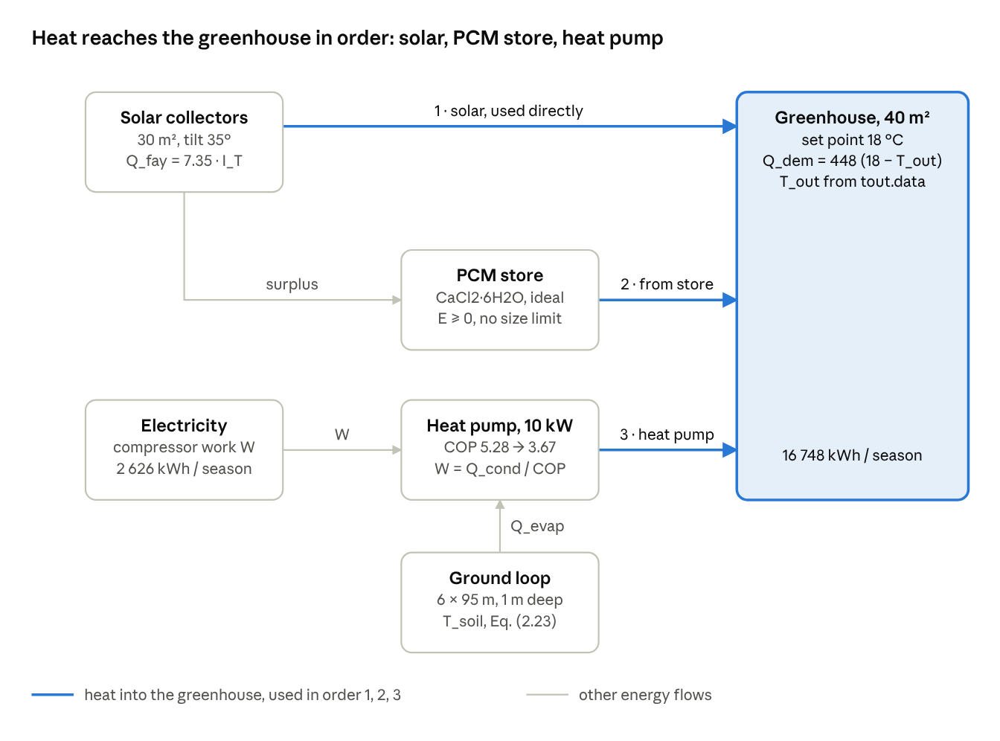

# Building the thesis system in Simcenter Amesim

This guide builds the thesis system in Simcenter Amesim exactly as the thesis calculates it: same equations, same hourly input data, same values and the same hour-by-hour control order. Built correctly, Level A gives the thesis results: 10 821 kWh of condenser heat, 2 626 kWh of compressor work and 2 265 heat-pump hours.

The thesis is an hourly energy balance with an ideal store, so **Level A** (the replica) is built mostly from Signal blocks, plus a small Thermal network that checks the greenhouse temperature. **Level B** is an optional physical version with water loops and a real PCM store; it goes beyond the thesis, so its results will differ.

Input tables are in [`amesim/`](../amesim/). Amesim submodel names differ between versions and licences, so components are named by library and function. In Submodel mode, press **Premier submodel** first, then check each icon against the description here.

Build in this order and run a one-day test after each step: inputs → heat demand and solar heat → PCM store → heat pump → ground check → greenhouse check and outputs.



## Libraries and setup rules

| Library | Used for |
| --- | --- |
| Signal, Control and Observers | Time tables, gains, sums, products, f(x) and f(x,y) expressions, relays, integrators |
| Thermal | Greenhouse check: temperature source, conductance, thermal capacity, heat flow source |
| Thermal-Hydraulic | Level B only: water loops, chambers, pumps |

1. **Units.** Signals carry no units. This guide uses W, J, °C and s; energies are converted to kWh with a gain of 1/3.6e6.
2. **Time tables.** Time-table source from a 1D table file, simulation time as input, linear interpolation, extrapolation "hold last value".
3. **Time origin.** t = 0 s is 1 October 2013, 00:00. The season ends at 15 724 800 s.
4. **Expressions.** In f(x) and f(x,y) the inputs are x and y; max, min, exp and cos are available.
5. **Thermal causality.** Connect capacity-type items to flow-type items.
6. **Heat flow sign.** A positive heat flow source adds heat to its node.

## Global parameters (thesis values)

| Name | Meaning | Value | Unit | Thesis source |
| --- | --- | --- | --- | --- |
| UA_GH | (A1/R1 + A2/R2)·f_w·f_c·f_s = (72.5 + 46.56)/0.26 × 1.03 × 1.00 × 0.95 | 448.078 | W/K | Eq. (3.1) |
| T_SET | Greenhouse set point (tomato) | 18 | °C | Table 3.5 |
| K_SOL | A_c·η_kol·η_m = 30 × 0.35 × 0.70 | 7.35 | m² | Eq. (3.6) |
| COP | Monthly COP, Oct → Mar | 5.28, 4.79, 4.07, 3.67, 3.92, 4.38 | – | Table 3.7 |
| R_EV | (h1 − h4)/(h2 − h3) for October = 148/172 | 0.8605 | – | Tables 4.2–4.7 |
| Q_HP | Heat-pump capacity | 10 000 | W | Section 3.4 |
| UA_GHX | n·m·c_p·[1 − exp(−k_t·F(z)·L/(m·c_p))] | 1181.96 | W/K | Eq. (2.24) |
| G_GHX | n·k_t·F(z)·L = 6 × 2.42 × 1.052554 × 90 | 1375.48 | W/K | Eq. (2.24) |
| T_S1 | Ground-loop inlet water | 2 | °C | Section 3.4 |
| m_mod | Flow per module, u = 0.5 m/s, d_i = 21.1 mm | 0.1748 | kg/s | Eq. (2.25) |
| T_m, T_0, D | Soil model mean, amplitude, damping at 1 m | 17.12, 13.98, 0.3585 | °C, K, – | Eq. (2.23) |
| PCM | CaCl₂·6H₂O: 29 °C, 187 kJ/kg, 1710 kg/m³, 1.94 m³, 3317 kg | – | – | Section 3.6 |

## Inputs

| Icon | Component (Signal) | File | Output |
| --- | --- | --- | --- |
| TAB_TOUT | Time table from a 1D table file | tout.data | T_out (°C) |
| TAB_IT | Same | itilt.data | I_T (W/m²) |
| TAB_COP | Same | cop.data | COP |
| TAB_SOIL | Same | tsoil.data | T_soil at 1 m (°C) |

If a file is refused, open it in the Table Editor and save it again.

## Step 1 – Heat demand and solar heat

```
Q_dem = max(0, 448.078·(18 − T_out))      Eq. (3.1)
Q_fay = 7.35 · I_T                          Eq. (3.6)
Q_dir = min(Q_fay, Q_dem);  Q_ch = Q_fay − Q_dir;  Q_def = Q_dem − Q_dir
```

| Icon | Component (Signal) | Setting | Output |
| --- | --- | --- | --- |
| F_DEM | f(x), x = T_out | `max(0, 448.078*(18 - x))` | Q_dem (W) |
| G_SOL | Gain on I_T | 7.35 | Q_fay (W) |
| F_DIR | f(x,y), x = Q_fay, y = Q_dem | `min(x, y)` | Q_dir (W) |
| SUB_CH | Sum + Q_fay − Q_dir | – | Q_ch (W) |
| SUB_DEF | Sum + Q_dem − Q_dir | – | Q_def (W) |

Checks: at t = 0 s, Q_dem = 4 481 W (thesis 4 480 W); at t = 25 200 s, Q_fay = 407 W (thesis 404 W with I_T rounded).

## Step 2 – PCM store and dispatch order

The store is ideal, as in the thesis: dE/dt = Q_ch − Q_dis, E ≥ 0, Q_dis = Q_def · S_E with S_E = 1 while E > 0.

| Icon | Component (Signal) | Setting | Output |
| --- | --- | --- | --- |
| SUM_E | Sum + Q_ch − Q_dis | – | dE/dt (W) |
| INT_E | Integrator | initial 0 J, lower limit 0 J, no upper limit | E (J) |
| REL_E | Relay with hysteresis on E | ON above 1000 J, OFF below 1 J | S_E |
| MUL_DIS | Product Q_def × S_E | – | Q_dis (W) |

Expected: E peaks at 108.5 kWh (3.906e8 J) at the end of the 16:00 hour of 17 October 2013 (t = 1 443 600 s) and ends at 13.3 kWh. The thesis states 150.3 kWh (see [thesis-errata.md](thesis-errata.md)). For a real tank size, set the upper limit to 173 kWh = 6.228e8 J.

## Step 3 – Heat pump

```
Q_cond = Q_def − Q_dis;   W = Q_cond / COP;   Q_evap = 0.8605 · Q_cond
```

| Icon | Component (Signal) | Setting | Output |
| --- | --- | --- | --- |
| SUB_HP | Sum + Q_def − Q_dis | – | Q_cond (W) |
| DIV_W | Division, x = Q_cond, y = COP | – | W (W) |
| G_EV | Gain on Q_cond | 0.8605 | Q_evap (W) |
| CMP_HP | Comparator on Q_cond | 1 if > 1 W | HP_on |

| Month | T_evap (°C) | h1 | h2s | h2 | h3 = h4 (kJ/kg) | COP |
| --- | --- | --- | --- | --- | --- | --- |
| Oct | 10 | 404 | 423 | 427.75 | 256 | 5.28 |
| Nov | 6 | 402 | 423 | 428.25 | 256 | 4.79 |
| Dec | 2 | 399 | 424 | 430.25 | 256 | 4.07 |
| Jan | −2 | 397 | 425 | 432.00 | 256 | 3.67 |
| Feb | 0 | 398 | 424 | 430.50 | 256 | 3.92 |
| Mar | 4 | 400 | 423 | 428.75 | 256 | 4.38 |

R_EV = 0.8605 reproduces Tables 4.2–4.7. For each month's own ratio use `evap_ratio_monthly.data` instead of G_EV.

## Step 4 – Ground heat exchanger check

```
Q_top     = 1181.96 · (T_soil − 2)   at the design flow, 0.1748 kg/s per module   Eq. (2.24)
Q_top,max = 1375.48 · (T_soil − 2)   at unlimited flow
```

| Icon | Component (Signal) | Setting | Output |
| --- | --- | --- | --- |
| F_GHX | f(x), x = T_soil | `1181.96*(x - 2)` | Q_top (W) |
| F_GMAX | f(x), x = T_soil | `1375.48*(x - 2)` | Q_top,max (W) |
| SUB_M | Sum + Q_top − Q_evap | – | margin (W) |

Expected with R_EV = 0.8605: the margin is negative in 30 hours (2 in January, 28 in February); in 3 hours (3 Feb 06:00, 5 Feb 05:00 and 06:00) Q_evap is above Q_top,max. With the monthly ratios: 19 hours (all in February) and 0 hours. Thesis check: 3 Feb 06:00, soil 7.58 °C → 6.60 kW at design flow.

## Step 5 – Greenhouse check and energy outputs

| Icon | Component | Value |
| --- | --- | --- |
| T_OUT | Temperature source (Thermal), input TAB_TOUT | – |
| G_ENV | Thermal conductance | 448.078 W/K |
| AIR | Thermal capacity | 156 kg, 1005 J/(kg·K), initial 18 °C |
| HS_HEAT | Heat flow source, input Q_dir + Q_dis + Q_cond | – |

AIR stays at 18.0 °C whenever the outdoor air is colder. Integrate Q_dem, Q_fay, Q_dir, Q_ch, Q_dis, Q_cond, W and Q_evap, then multiply by 1/3.6e6 for kWh; integrate HP_on and multiply by 1/3600 for hours.

## Simulation settings and expected results

Final time 15 724 800 s, print interval 3600 s, default variable-step solver with discontinuity handling.

| Output | Thesis | Expected |
| --- | --- | --- |
| Heat demand | 16 748 kWh | 16 748 kWh |
| Useful solar heat | – | 5 941 kWh |
| Solar used directly | – | 2 621 kWh |
| To / from the store | – | 3 320 / 3 307 kWh |
| Condenser heat | 10 820 kWh | 10 821 kWh |
| Compressor work | 2 626 kWh | 2 626 kWh |
| Heat from the ground (R_EV 0.8605) | – | 9 311 kWh |
| Heat-pump hours | 2 265 h | slightly below 2 265 h (continuous counting) |
| Peak of E | 150.3 kWh | 108.5 kWh |

Monthly values are in [`amesim/expected_monthly_results.csv`](../amesim/expected_monthly_results.csv).

## Level B – physical version (beyond the thesis)

Level B keeps every thesis value but replaces the energy counters with water loops, a PCM store with a real temperature and finite heat exchangers (the follow-up study proposed in Chapter 5). [A] marks my assumptions.

| Part | Components | Values |
| --- | --- | --- |
| Setup | Thermal-Hydraulic, one water fluid; one pressure reference per loop | 2 bar abs [A] |
| Solar collectors | Chamber + heat flow source Q_fay = 7.35·I_T; mass flow source on while I_T > 0 | 12 L [A], 0.6 kg/s [A] |
| PCM store | Thermal capacity with temperature-dependent specific heat; store heat exchanger | 3 317 kg; 1.4 / 95 / 2.2 kJ/(kg·K) below 28 / 28–30 / above 30 °C [A]; 500 W/K [A] |
| Greenhouse coil | Chamber + conductance to AIR; condenser loop flow | 690 W/K; 0.217 kg/s |
| Heat pump | Condenser chamber + Q_cond; COP from cop.data | 3 L [A] |
| Ground loop | 5 chambers in series, each with a conductance to T_SOIL; evaporator chamber with −Q_evap | 275.1 W/K each; 1.049 kg/s; 5 L [A] |
| Control | Solar to coil while AIR < 18 °C, else to store; store discharges while AIR < 18 °C and PCM > 25 °C [A]; heat pump on below 17.5 °C [A] | – |

Run Level A and Level B with the same input files and compare the condenser heat, compressor work and heat-pump hours.
