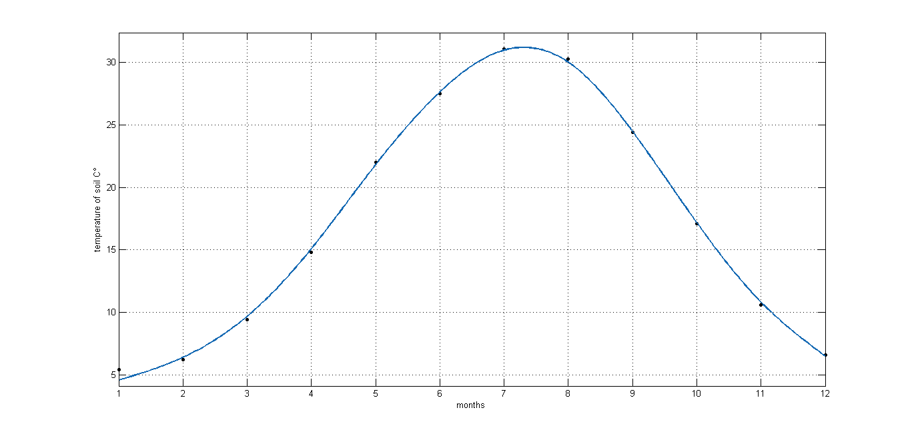
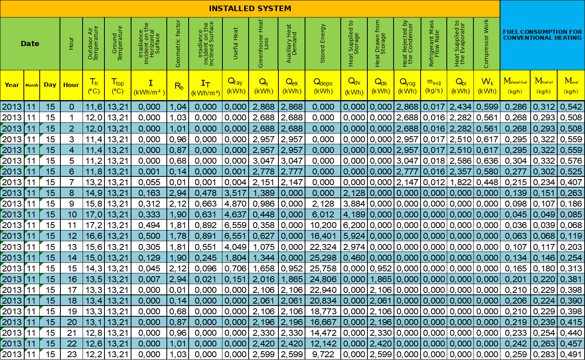

# Methodology

The model is an hourly, steady-state energy balance over one heating season (4368 hours). Each component is a closed-form equation from the thesis. Equation numbers below are the thesis numbers; the code is in `src/greenhouse_gshp/physics.py` and `src/greenhouse_gshp/simulation.py`.

## 1. Greenhouse heat loss

Gable-roof greenhouse, 8 m × 5 m floor (40 m²), 2.5 m walls, 1.5 m roof rise, double-layer polyethylene cover. The set point is 18 °C, the optimum for tomatoes.

```
Q_s = (A1/R1 + A2/R2) · (T_i − T_d) · f_w · f_c · f_s          (3.1)
```

| Symbol | Value | Note |
| --- | --- | --- |
| A1 | 72.5 m² | side walls, end walls and gable triangles |
| A2 | 46.56 m² | two roof slopes, 2 × 2.91 m × 8 m |
| R1 = R2 | 0.26 m²K/W | double-layer PE film with air gap |
| f_w, f_c, f_s | 1.03, 1.00, 0.95 | wind, construction and system factors |
| Effective UA | 448.08 W/K | all of the above combined |

Heat gains (solar gain through the cover, plants, people) are neglected. Hours with T_d > 18 °C give a negative loss; they count as zero demand.

## 2. Solar collectors

Flat-plate collectors, 30 m² (17 units of 1.8 m²), facing south, tilted 35°.

```
δ  = 23.45 · sin(360 · (284 + n) / 365)                            (2.1)
ω  = 15 · (12 − h)                                                  (2.2)
R_b = [cos(φ−β)cosδ cosω + sin(φ−β) sinδ] / [cosφ cosδ cosω + sinφ sinδ]   (2.4)
I_T = I · R_b                                                       (3.5)
Q_fay = A_c · I_T · η_kol · η_m = 30 · I_T · 0.35 · 0.70            (3.6)
```

φ = 40.1° (Bursa), β = 35°, h = clock hour. η_kol = 0.35 is the seasonal efficiency of a double-glazed collector for October–March; η_m = 0.70 covers piping and storage.

R_b is applied to the total (global) horizontal irradiation. The published tilted values equal I · R_b in 1928 of the 2063 hours with sunshine. The other 135 hours are mostly at 07:00 and 17:00, when the sun is at or below the horizon at the clock hour, so Eq. (2.4) becomes negative or very large. The thesis used R_b ≈ 0.01 in most of these hours and values between 5 and 10 in a few. The model therefore reads the published tilted series. `simulation.run(recompute_tilt=True)` recomputes it from Eq. (2.4) with R_b = 0 below the horizon. That raises the season's useful solar heat by about 2 % (6055 instead of 5941 kWh), because R_b grows very large just after sunrise; the payback periods move to 36, 125 and 156 months.

## 3. Heat pump

Water-to-water heat pump, 10 kW heating capacity, chosen from the peak loss of 9.58 kW (16 December 2013, 06:00). Condensing temperature 40 °C (water 38 °C supply, 27 °C return). The evaporator temperature follows the monthly soil temperature (Table 3.6). Enthalpies were read from the CATT3 program.

```
h2  = h1 + (h2s − h1) / η_K                                         (2.9)
w_k = (h2s − h1) / (η_K · η_Mk · η_EM · η_KK)                        (2.13)
q_y = h2 − h3 ,  q_b = h1 − h4 ,  h4 = h3                           (2.10–2.12)
COP = q_y / w_k                                                      (2.14)
```

η_K = 0.80 (isentropic), η_Mk = 0.80 (mechanical), η_EM = 0.95 (belt), η_KK = 0.96 (motor).

| Month | T_evap (°C) | h1 | h2s | h2 | w_k (kJ/kg) | COP |
| --- | --- | --- | --- | --- | --- | --- |
| Oct | 10 | 404 | 423 | 427.75 | 32.55 | 5.28 |
| Nov | 6 | 402 | 423 | 428.25 | 35.98 | 4.79 |
| Dec | 2 | 399 | 424 | 430.25 | 42.83 | 4.07 |
| Jan | −2 | 397 | 425 | 432.00 | 47.97 | 3.67 |
| Feb | 0 | 398 | 424 | 430.50 | 44.54 | 3.92 |
| Mar | 4 | 400 | 423 | 428.75 | 39.41 | 4.38 |

h3 = h4 = 256 kJ/kg in every month. The model uses the COP rounded to two decimals, as the thesis did.

## 4. Soil temperature and ground heat exchanger

### Soil temperature at 1 m

```
T(x,t*) = T_m + T_0 · exp(−x·√(π/(a·P))) · cos(2π·t*/P* − x·√(π/(a·P)))   (2.23)
```

T_m = 17.12 °C and T_0 = 13.98 K come from a MATLAB fit of the 20-year monthly 5 cm soil temperatures (Table 3.8). t* counts days from 3 July (warmest day), so 1 October is day 91.



*Figure 3.7 of the thesis: fit of the monthly 5 cm soil temperatures, which gives T_m and T_0.*
 With x = 100 cm, a = 0.00775 cm²/s (0.067 m²/day, moist soil) and P = 1 year, the damping term is 0.3585. The result runs from 20.59 °C (1 October) to 7.35 °C (20 January).

### Pipe length

```
L₁ = 572 · [(COP − 1)/COP] · (R_b + R_t · F_i) / (T_d − T_min)       (3.2)
L  = Q · L₁                                                         (3.3)
```

COP = 5.28, R_b = 0.17 m·K/W (¾" horizontal pipe), R_t = 1.02 m·K/W (soil, 1 m depth), F_i = 0.477, T_d = 7.35 °C, T_min = 2 °C → L₁ = 56.90 m/kW and L ≈ 570 m, built as **6 modules × 95 m** of ¾" PE pipe (d_i = 21.1 mm) at 1 m depth.

F_i is the heating operating factor: average condenser output while running (10 820 kWh / 2265 h = 4.77 kW) over the 10 kW capacity.

### Heat from the ground

```
m     = ρ · u · π d_i² / 4 = 0.1748 kg/s per module (u = 0.5 m/s)   (2.25)
Q_top = n · m · c_p · (T_top − T_s1) · [1 − exp(−k_t · F(z) · L / (m · c_p))]   (2.24)
```

n = 6, c_p = 4212.5 J/kgK, T_s1 = 2 °C (constant inlet), k_t = 2.42 W/mK, F(z) = 1.052554, L = 90 m (the length used in the thesis worked example). At the design flow the ground delivers 1182 W per kelvin of (T_top − 2 °C). When the evaporator needs more, the module flow is raised by iteration; on 3 February at 06:00 this gives 0.735 kg/s, as in the thesis.

The ground heat does not feed back into the COP: the COP is fixed by month. The model reports, for each hour, the flow the ground loop would need. It exceeds the design flow in 19 hours, peaks at 0.755 kg/s (5 February, 05:00), and stays below the physical limit of Eq. (2.24) in every hour.

## 5. Latent-heat storage (PCM)

CaCl₂·6H₂O: melting point 29 °C, latent heat 187 kJ/kg, density 1710 kg/m³.

```
V_PCM = 1.15 · E_peak · 3600 / (ρ · H)      (3.7, with a 15 % margin)
V_d   = 1.10 · V_PCM                         (container allowance)
```

The store is ideal: no capacity limit, no heat loss and perfect heat transfer during charging and discharging (the thesis states this assumption in Chapter 5).

## 6. Hourly control logic

For every hour:

1. Q_dem = max(Q_s, 0).
2. Solar heat goes to the greenhouse first: Q_fay-kalan = min(Q_fay, Q_dem).
3. A solar surplus charges the store: Q_dv = Q_fay − Q_fay-kalan.
4. A deficit is drawn from the store first: Q_dk = min(E, Q_dem − Q_fay).
5. The heat pump covers the rest: Q_yoğ = Q_dem − Q_fay − Q_dk, with W_k = Q_yoğ / COP and Q_bi = Q_yoğ · q_b / q_y.

The thesis ran this logic in a spreadsheet; one day of it is shown below (Table 4.1, 15 November 2013). `results/hourly_results.csv` holds the same columns for all 4368 hours.



## 7. Economics

Capital cost (Eq. 4.1) = ground-loop pipe + heat pump + collectors + PCM + excavation:

| Item | Calculation | TL |
| --- | --- | --- |
| Ground-loop pipe | 95 m × 6 × 2.67 TL/m × 1.32 | 2 009 |
| Excavation | 6 × 95 m × 1 m × 0.5 m × 8 TL/m³ | 2 280 |
| PCM | 0.6 TL/kg × 1.94 m³ × 1710 kg/m³ | 1 990 |
| Solar collectors | 17 × 200 TL | 3 400 |
| Heat pump, 10 kW | market survey | 12 000 |
| **Total** | | **21 679** |

Running cost uses the present-worth method with monthly payments equal to 1/12 of the season's energy:

```
C(v) = C_capital + Y_month · c_unit · [(1+i)^v − 1] / [(1+i)^v · i]   (4.7, 4.9)
```

i = 0.0083 per month (10 % per year), electricity 0.3645 TL/kWh. Boilers: diesel and fuel oil 6400 TL, coal 4400 TL. Fuel use follows Eq. (4.8), M = Q_s / (D · η), with the data below.

| Fuel | Lower heating value (kcal/kg) | Boiler efficiency | Price (TL/kg) | Season use (kg) |
| --- | --- | --- | --- | --- |
| Diesel | 10 256 | 0.84 | 4.15 | 1672 |
| Fuel oil | 9 875 | 0.80 | 1.82 | 1823 |
| Imported coal | 7 000 | 0.65 | 1.05 | 3166 |

All prices are 2013–2016 market values in Turkish lira; they show the method, not today's costs.

## 8. Reproduction accuracy

`tests/test_reproduction.py` checks the model against the published numbers:

| Check | Tolerance |
| --- | --- |
| Hourly heat loss and useful solar heat (Figures 3.3, 3.11), all 4368 hours | < 0.01 Wh |
| Daily soil temperature (Figure 3.8), all 182 days | < 0.011 °C |
| Seven daily rows of Tables 4.2–4.6, eight columns each | < 0.002 kWh |
| Season totals: demand, condenser heat, compressor work, operating hours | exact to the published digits |
| Cost curves, months 1–180 (Figure 4.2) | < 0.05 TL |
| Payback against diesel, fuel oil and coal | 36, 126, 158 months |
